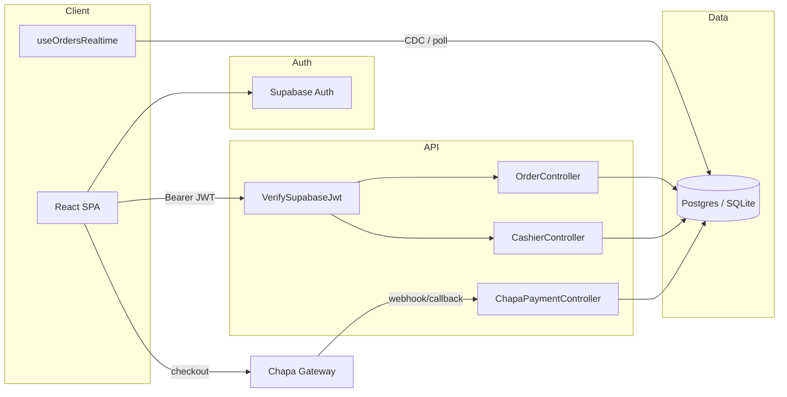

# Internship Presentation Deck (15 min)

**Project (from repo):** Restaurant Order & Table Management / Restaurant Operations & Order Management System  
**One-liner (from README + architecture guide):** A full-stack multi-role restaurant platform for menu browsing, dine-in/delivery orders, kitchen queue, cashier payments (Chapa + cash), reservations, delivery dispatch, and admin analytics.  
**Tech stack (from code):** React 19 + TypeScript + Vite + Tailwind 4 (`client/`); Laravel 13 + PHP 8.3 (`server/`); Supabase Auth + PostgreSQL + Realtime; Chapa payments (ETB); shared contracts in `@intern/shared`; CI via `.github/workflows/ci.yml`.

> Fill `[CONFIRM]` items before presenting. Do not invent metrics.

---

# STEP 1 — ANALYSIS

## 1. Problem & who it is for

Restaurants often run on fragmented tools: paper tickets, phone-based delivery coordination, manual cash logs, and unclear staff permissions. This project targets that gap with one synced web app for:

| Role | What they do in the product |
|------|-----------------------------|
| Customers | Browse Ethiopian menu, cart checkout, Chapa/cash pay, reserve tables, track orders |
| Kitchen | Live queue; advance dine-in/delivery statuses |
| Cashier | Validate Chapa-paid orders; collect open cash (`CashierController`, `/payments`) |
| Delivery/driver | Accept/assign deliveries; mark out for delivery → delivered |
| Host/manager | Tables, reservations, menu change approvals |
| Admin | Dashboard analytics + role/permission management (`/admin`) |

## 2. Architecture overview

```
React SPA (Vite :5173)
  ├─ Supabase Auth (or local Laravel auth via AUTH_DRIVER=local)
  ├─ Bearer JWT → Laravel API (:8000/api)
  ├─ Optional Supabase Realtime on `orders` (+ 5s / 12s poll fallback)
  └─ Chapa hosted checkout (return + webhook)

Laravel API
  ├─ VerifySupabaseJwt → upsert/load User
  ├─ Gates/Policies (permissions from shared/types + Permission model)
  ├─ Controllers/Services (orders, payments, reservations, admin, …)
  └─ SQL → SQLite (local/tests) or Supabase Postgres (pooler)

Chapa ──webhook/callback──► ChapaPaymentController → markPaid → cashier approve → kitchen sees order
```

**Key files:** `client/src/App.tsx`, `client/src/services/api.ts`, `client/src/hooks/useOrdersRealtime.ts`, `server/routes/api.php`, `server/app/Http/Middleware/VerifySupabaseJwt.php`, `server/app/Models/Order.php`.

## 3. Tech stack & why it fits

| Choice | Why it makes sense here |
|--------|-------------------------|
| React 19 + Vite + TS | Fast SPA for many role-specific screens; lazy routes in `App.tsx` |
| Tailwind 4 | Rapid UI for menu/admin/kitchen without a heavy design system |
| Laravel 13 API | Clear REST boundary, FormRequests, Policies, Eloquent |
| Supabase Auth + JWT | Offloads signup/login; Laravel verifies tokens (`SupabaseJwtService`) |
| Supabase Postgres | Hosted DB + Realtime CDC for kitchen; SQLite for local/CI |
| Chapa | Local Ethiopia payment gateway (ETB) — matches menu pricing |
| `@intern/shared` | Single source for roles/permissions/order types across FE/BE contract |
| PHPUnit + GitHub Actions | API regression safety; client lint/build gate |

## 4. Key features (ranked by impressiveness / relevance)

1. **Multi-role order lifecycle + payment gate** — kitchen only sees payment-settled orders (`Order::scopePaymentSettled`; cashier approval for Chapa).
2. **RBAC** — 8 roles / 11 permissions in `shared/types/index.ts`; Gates + Policies; admin roles UI.
3. **Realtime kitchen queue** — `useOrdersRealtime` (Realtime + polling fallback).
4. **Chapa + cash desk** — `ChapaPaymentService`, `CashierController`, receipts, staff notifications.
5. **Delivery dispatch** — driver assign, dual confirmation (delivered / received).
6. **Reservations with overlap checks** — `ReservationAvailabilityService`.
7. **Admin analytics dashboard** — revenue, AOV, top items (`AdminDashboardController`).
8. **Menu CRUD + change proposals** — managers approve kitchen/host proposals.
9. **Local auth fallback** — `AUTH_DRIVER=local` when Supabase unreachable.
10. **Security/perf extras** — rate limits, security headers, JWT claim cache (90s), menu/dashboard caching, keyset pagination.

## 5. Interesting technical challenges (solved in code)

1. **Paid ≠ kitchen-ready for Chapa** — `paymentSettled` requires `cashier_approved_at` after Chapa `paid` (tested in `PaymentApiTest`).
2. **JWT verification across environments** — ES256 JWKS (prod) + HS256 for tests; token claims cached 90s in `VerifySupabaseJwt`.
3. **Realtime not always available** — SQLite/local auth → poll; Realtime subscribe with delayed poll fallback (`useOrdersRealtime.ts`).
4. **Invalid status jumps** — state machine in `Order::allowedNextStatuses()` + role checks in `canUserTransition()`.
5. **Reservation double-booking** — overlap query in `ReservationAvailabilityService` (docs also mention `lockForUpdate` — verify in `ReservationController` before claiming concurrency locking on stage).
6. **Chapa quirks** — title length limits, skip non-public callback URLs (`ChapaPaymentService`).

## 6. Code quality observations

**Strengths**
- Clear monorepo split (`client` / `server` / `shared`).
- Strong API test suite (~70+ test methods across Feature/Unit: orders, payments, RBAC, reservations, delivery, JWT, admin, local auth).
- CI: client lint+build; server Pint + `php artisan test`.
- Authorization layered (middleware → Gates/Policies → model transition rules).
- Shared TypeScript contracts reduce FE/BE drift.

**Weaknesses / risks**
- **No client/E2E tests** found — UI regressions rely on manual QA.
- **Docs drift** (see §7) — risky if you quote README instead of code.
- **Permission bootstrap friction** — new signups need grants (README); easy to demo-fail if forgotten.
- **Dual auth modes** (Supabase vs local) increase cognitive load and edge cases.
- **Architecture guide marketing claims** (“sub-millisecond”, “zero-latency”) are **not measured in repo** — do not present as facts.
- Spatie-style wording in the architecture HTML is metaphorical; permissions are custom Laravel Gates, not Spatie package.

## 7. Gaps: documentation vs code

| Doc claim | Actual code |
|-----------|-------------|
| README: reservations / permission admin “not built yet” | **Built**: `ReservationController`, `/admin/roles`, `AdminRolesPage` |
| README: Laravel 12 / React implied older | **Laravel ^13.8**, **React 19** |
| `docs/architecture.md`: “No domain controllers” / scaffold only | Full domain API exists |
| Architecture HTML: React 18, Axios client | React 19; `api.ts` uses **`fetch`**, not Axios |
| Architecture HTML: `VITE_API_URL` | Client uses **`VITE_API_BASE_URL`** (per README) |
| README planned “auto-grant can_place_order” | Still operational concern unless seeded/local accounts used |

**Trust order for claims:** code + PHPUnit > README > architecture HTML pitch language.

## 8. Clarifying questions (answer these; deck uses `[CONFIRM]` until you do)

1. **What is your exact role?** (e.g. auth/JWT, orders/kitchen, Chapa/cashier, admin UI, RBAC, docs) — Slide 6 depends on this.
2. **Team size and who did what?** Git history is dominated by `yabuxd` — was this solo or a team?
3. **Audience?** Mentors only, mixed technical/non-technical, or managers?
4. **Goal of the talk?** Technical depth, business value, or “what I learned”?
5. **Any real metrics you can use?** (pilot restaurant, demo users, order volume, latency measurements) — otherwise keep results qualitative + test/CI counts only.

---

# STEP 2 — SLIDE DECK (12 slides ≈ 12 minutes speaking)

**Assumptions until you confirm:** Audience = mixed mentors/managers; Goal = show what was built + technical depth; Your contribution = [CONFIRM — default deep-dive uses payment gate + order state machine as “system highlight”; swap Slide 6 to your work].

---

## Slide 1 — Title + hook  
**Title:** One app. Every role on the restaurant floor.  
**On-slide:**
- Restaurant Operations & Order Management System
- Internship project — React + Laravel + Supabase + Chapa
- Presenter: [CONFIRM name] · Role: [CONFIRM]
- Hook: “From menu to kitchen to cashier to driver — without paper tickets.”

**Visual:** Logo + one screenshot collage (menu + kitchen queue), e.g. `docs/assets/screenshots/fig_2_2_login.png` and `fig_2_6_kitchen_queue.png`.

**Speaker notes:**  
“Hi, I’m [CONFIRM]. Over this internship I helped build a restaurant operations platform that replaces paper tickets and scattered chats with one web app. In the next twelve minutes I’ll show the problem, the architecture, a short demo path, and the technical decisions that make multi-role operations safe.”

**Time:** 0:45  
**Transition:** “So why does a restaurant need software like this at all?”

---

## Slide 2 — The problem and why it matters  
**Title:** Paper tickets and phone calls don’t scale across roles  
**On-slide:**
- Kitchen, cashier, host, and drivers work from different “sources of truth”
- Payment confirmation and cooking start get out of sync
- Table bookings collide without shared availability
- Permissions are informal (“just give them the tablet”)

**Visual:** Simple “before” diagram: Customer → WhatsApp/phone → Kitchen paper → Cash drawer (disconnected boxes).

**Speaker notes:**  
“A dine-in guest, a delivery order, and a Chapa payment each touch different people. If the kitchen starts cooking before payment is confirmed, or two hosts book the same table, you lose money and trust. The product problem is coordination under clear roles — not just a prettier menu.”

**Time:** 1:00  
**Transition:** “Here’s what we built to fix that coordination problem.”

---

## Slide 3 — The solution at a glance  
**Title:** One platform: browse, pay, cook, deliver, manage  
**On-slide:**
- Customers: Ethiopian menu, cart, dine-in or delivery, Chapa or cash
- Staff: kitchen queue, cashier desk, deliveries, reservations, tables
- Admins: analytics + role assignments
- Shared rules: permissions in `@intern/shared` enforced by Laravel Gates

**Visual:** Role swimlane (Customer / Cashier / Kitchen / Driver / Admin) with arrows between pages (`/menu` → `/payments` → `/orders/queue` → `/orders/deliveries` → `/admin`).

**Speaker notes:**  
“The solution is a single SPA talking to a Laravel API. Customers place orders; cashiers reconcile money; kitchen only works payment-settled tickets; drivers move delivery orders; admins see health of the business and who can do what. Same data model, different screens per permission.”

**Time:** 1:00  
**Transition:** “Let me show how those pieces connect under the hood.”

---

## Slide 4 — Architecture and tech stack  
**Title:** JWT at the edge, Postgres at the core, Realtime for the kitchen  
**On-slide:**
- React 19 SPA → Bearer JWT → Laravel 13 API → Postgres (or SQLite locally)
- Supabase Auth issues tokens; `VerifySupabaseJwt` verifies and loads `users`
- Kitchen: Supabase Realtime on `orders` + polling fallback
- Payments: Chapa initialize / verify / webhook → cashier approval gate

**Visual:** Mermaid (paste into slides as image or keep as speaker backup):



**Speaker notes:**  
“When you sign in, Supabase — or our local auth driver — gives you a JWT. Every API call sends that token. Laravel’s `VerifySupabaseJwt` middleware checks it, often using a short cache of claims, then attaches the user. Domain logic lives in controllers and services. For the kitchen screen, we subscribe to Postgres changes on the orders table when Realtime is available; otherwise we poll so local SQLite demos still work. Chapa is deliberately outside the Laravel process: we create a checkout URL, then trust verify and webhook paths to mark payment paid.”

**Time:** 1:30  
**Transition:** “Architecture is abstract — let’s walk a concrete happy path as if this were a live demo.”

---

## Slide 5 — Key features / live demo flow  
**Title:** Follow one order from cart to kitchen  
**On-slide (demo steps):**
1. Login as customer → `/menu` → add items → checkout (cash or Chapa)
2. If Chapa: pay → cashier `/payments` → Approve → order becomes kitchen-visible
3. Kitchen `/orders/queue` → Preparing → Ready → Served (dine-in)
4. Optional: delivery path → assign driver → Out for delivery → Delivered → Received
5. Admin `/admin` glance: orders/revenue snapshot

**Backup if demo fails:** Walk screenshots in `docs/assets/screenshots/` (`fig_2_5_orders.png`, `fig_2_6_kitchen_queue.png`, `fig_2_8_cashier.png`, `fig_2_7_admin.png`) + cite `PaymentApiTest` / `OrdersApiTest` as proof of behavior.

**Demo script (spoken):**  
“I’ll place a cash dine-in order first — cash uses `payment_status = not_required`, so it appears in the kitchen immediately after place order. Then I’ll contrast with Chapa: paid online still waits for cashier approval because of `scopePaymentSettled`. That’s intentional — we don’t cook on an unverified payment.”

**Speaker notes:**  
Define jargon lightly: “JWT means the signed login token. RBAC means role-based access control — permissions like `can_update_order_status`. Realtime means the kitchen UI updates when the database row changes.”

**Time:** 2:00 (tight; cut step 4 first if late)  
**Transition:** “The payment gate is also where a lot of my technical focus shows up — [CONFIRM / adjust].”

---

## Slide 6 — Deep dive: MY contribution  
**Title:** [CONFIRM your title — default:] Cooking only starts after money is trusted  
**On-slide:**
- Chapa `paid` ≠ kitchen queue visibility
- Cashier sets `cashier_approved_at` (`Order::approveByCashier`)
- Queue query uses `paymentSettled()` in `OrderController::queue`
- Covered by feature tests (`PaymentApiTest`)

**Code snippet (≤10 lines) — explain aloud:**

```php
// server/app/Models/Order.php — scopePaymentSettled
return $query->where(function ($builder) {
    $builder
        ->where('payment_status', self::PAYMENT_NOT_REQUIRED)
        ->orWhere(function ($chapa) {
            $chapa->where('payment_status', self::PAYMENT_PAID)
                ->whereNotNull('cashier_approved_at');
        });
});
```

**If your real contribution differs, swap this slide to one of:**
- JWT: `SupabaseJwtService` + `VerifySupabaseJwt`
- Realtime: `useOrdersRealtime.ts`
- RBAC admin: `UserPermissionController` + `AdminRolesPage`
- Reservations: `ReservationAvailabilityService`
- Frontend routing/auth lock: `App.tsx` GuestRoute/ProtectedRoute

**Speaker notes:**  
“This is the business rule in code. Cash orders are `not_required`, so they pass. Chapa orders must be both paid and cashier-approved. The kitchen queue always calls this scope, so the UI cannot accidentally show unpaid Chapa tickets even if someone tampers with the client.”

**Time:** 1:30  
**Transition:** “That rule sounds simple — enforcing it across auth modes and live updates was harder.”

---

## Slide 7 — Biggest challenge and how we solved it  
**Title:** Live kitchen updates without breaking local SQLite demos  
**On-slide:**
- Challenge: Supabase Realtime needs Postgres CDC; local/dev often uses SQLite or local auth
- Solution: `useOrdersRealtime` — subscribe when possible; after 2.5s fall back to polling; local auth polls every 12s
- Parallel challenge: ES256 JWTs in prod vs HS256 in PHPUnit — handled in `SupabaseJwtService`

**Visual:** Sequence: Order status PATCH → DB row change → Realtime event **or** poll tick → queue refetch.

**Speaker notes:**  
“We wanted push updates for the kitchen, but internship demos and CI run on SQLite without Realtime. Rather than maintain two apps, the hook detects local auth or missing Supabase URL and polls the API. In cloud mode it tries Realtime first and only polls if the channel errors or times out. Separately, JWT verification had to support Supabase’s ES256 keys and simpler HS256 secrets for tests — same middleware, different verifier paths.”

**Time:** 1:15  
**Transition:** “How do we know this holds up? Let’s talk proof — tests and quality, not vanity metrics.”

---

## Slide 8 — Results, metrics, testing and quality  
**Title:** Proof is in the test suite and CI — not inventing dashboards  
**On-slide:**
- PHPUnit Feature/Unit coverage across orders, payments, RBAC, reservations, delivery, JWT, admin, local auth
- CI (`.github/workflows/ci.yml`): Node lint+build; PHP Pint + `php artisan test` on SQLite
- Functional outcomes (qualitative): multi-role flows work end-to-end in the app
- Production KPIs (orders/day, latency): **[CONFIRM — none in repo; do not invent]**

**Visual:** Screenshot of green CI or `php artisan test` summary + ERD `fig_2_9_erd.png`.

**Speaker notes:**  
“I’m not going to claim we cut kitchen wait time by X percent — we don’t have that field study in the repository. What we do have is automated API tests that lock the payment gate, status machine, and permissions, plus CI that blocks broken builds. That’s the honest internship-level proof of quality.”

**Time:** 1:00  
**Transition:** “If I restarted tomorrow, here’s what I’d change.”

---

## Slide 9 — Lessons learned and what I would improve  
**Title:** Ship features, then keep the docs honest  
**On-slide:**
- Lesson: shared permission constants prevent FE/BE drift (`shared/types/index.ts`)
- Lesson: fallbacks (poll, local auth) beat perfect-cloud-only designs for demos
- Improve: sync README/`docs/architecture.md` with shipped features
- Improve: add Playwright/Cypress for critical UI paths
- Improve: auto-grant baseline customer permission on signup **[CONFIRM if still open]**

**Speaker notes:**  
“The biggest process lesson is documentation lag. The README still says reservations and permission admin aren’t built, but the code has both. For a future employer demo, outdated docs hurt more than missing features. I’d also add browser tests — our PHPUnit suite is strong on the API, weak on the React layer.”

**Time:** 0:45  
**Transition:** “Looking forward, the roadmap is about hardening and productizing.”

---

## Slide 10 — Future roadmap  
**Title:** From internship demo to floor-ready product  
**On-slide:**
- Keep docs and OpenAPI/contract types in lockstep
- Frontend E2E + stronger observability (request IDs, payment audit trail)
- Production caching/Redis where JWT/menu cache already assumes it
- Product: online reservation waitlist, printer/KDS integration, richer refunds
- Ops: seed/onboarding so new staff accounts aren’t stuck without permissions

**Speaker notes:**  
“Technically I’d invest in observability around Chapa webhooks and cashier actions — money paths need an audit trail. Product-wise, a kitchen display integration and safer onboarding for roles would matter most to a real restaurant.”

**Time:** 0:45  
**Transition:** “Three things I want you to remember.”

---

## Slide 11 — Conclusion — 3 takeaways  
**Title:** Coordinate roles. Gate the kitchen on trusted payment. Prove with tests.  
**On-slide:**
1. Multi-role restaurant ops need one shared data model + RBAC — not separate apps
2. Payment settlement is a first-class workflow (Chapa paid → cashier approve → cook)
3. Realtime with polling fallback + PHPUnit/CI made the system demoable and regressable

**Speaker notes:**  
“If you remember nothing else: we unified the floor in one stack; we refused to let the kitchen cook on unverified Chapa payments; and we backed the rules with automated tests and CI.”

**Time:** 0:45  
**Transition:** “I’m happy to take questions — including the hard ones.”

---

## Slide 12 — Q&A  
**Title:** Ask me about auth, payments, or the order state machine  
**On-slide:**
- Topics ready: JWT middleware, `paymentSettled`, Realtime fallback, RBAC, Chapa
- Repo: `intern-project` (client / server / shared)
- Thanks — [CONFIRM]

**Speaker notes:**  
Pause. Smile. Repeat the question. If you don’t know: “I’d confirm in `OrderController` / the test file rather than guess.”

**Time:** ~3:00 reserved  
**Transition:** n/a

---

# STEP 3 — DELIVERY SUPPORT

## Timing plan (15:00 total)

| Min | Slide | If running late, cut… |
|-----|-------|------------------------|
| 0:00–0:45 | 1 Title | Keep hook; skip collage detail |
| 0:45–1:45 | 2 Problem | One example only |
| 1:45–2:45 | 3 Solution | Skip admin bullet |
| 2:45–4:15 | 4 Architecture | Don’t read Mermaid boxes; point once |
| 4:15–6:15 | 5 Demo | **Cut delivery path first**; use screenshots |
| 6:15–7:45 | 6 Deep dive | Keep code snippet; skip alternate contribution list |
| 7:45–9:00 | 7 Challenge | One challenge only (Realtime **or** JWT, not both) |
| 9:00–10:00 | 8 Results | Skip ERD; say “70+ API tests + CI” |
| 10:00–10:45 | 9 Lessons | Two bullets only |
| 10:45–11:30 | 10 Roadmap | One product + one tech item |
| 11:30–12:15 | 11 Takeaways | Read the three lines slowly |
| 12:15–15:00 | 12 Q&A | Buffer |

**Hard cut order if over time:** Slide 10 → Slide 9 → delivery half of Slide 5 → second challenge on Slide 7.

## Opening line
“For fifteen minutes, picture a kitchen that never cooks an unverified payment — and a floor where every role shares one source of truth.”

## Closing line
“We didn’t just ship screens — we encoded restaurant trust into `paymentSettled`, permissions, and tests you can run tonight with `php artisan test`.”

## 10 tough questions + strong answers

1. **Why Laravel instead of a Node API?**  
   Laravel gave us FormRequests, Policies, Eloquent, and a mature test harness quickly. The SPA is Node/React; the API benefits from Laravel’s authz patterns. Redis/cache and rate limiting plug in via Laravel config.

2. **Why verify JWTs in Laravel instead of calling Supabase on every request?**  
   `VerifySupabaseJwt` verifies locally (JWKS/secret) and caches claims ~90s. That cuts Auth API chatter while still rejecting bad tokens. User rows are upserted/loaded so domain FKs use stable UUIDs from `sub`.

3. **Can’t the client just hide unpaid orders?**  
   No. The queue endpoint applies `paymentSettled()` server-side. UI hiding is not security.

4. **What if the Chapa webhook never arrives?**  
   Client/API can verify via payment verify route (`OrderController::verifyPayment` / Chapa verify). Cashier desk lists awaiting validation. Exact ops runbook: [CONFIRM].

5. **How do you prevent invalid status jumps?**  
   `Order::allowedNextStatuses()` differs for dine-in vs delivery; `canUserTransition()` checks permissions (and driver identity for delivery advances).

6. **Is Realtime required in production?**  
   Strongly preferred for kitchen UX, but `useOrdersRealtime` falls back to polling — correctness doesn’t depend on WebSockets.

7. **SQLite in CI vs Postgres in prod — isn’t that a lie?**  
   Tradeoff: fast, free CI. Risk: Postgres-specific behavior (RLS, advisory locks) may diverge. We mitigate with feature tests on logic; for pooler/RLS we’d add a Postgres job — [CONFIRM if you have one].

8. **Where is Spatie Permission?**  
   Architecture HTML says “Spatie-style.” Implementation is custom `roles` / `permissions` / Gates — not the Spatie package. Be honest.

9. **What’s your biggest security risk today?**  
   Misconfigured env secrets; overly broad role grants; Chapa webhook authenticity must stay enforced; local auth driver if left enabled in production. Also: keep `SUPABASE_SERVICE_ROLE_KEY` server-only.

10. **What did *you* personally build?**  
   Answer with [CONFIRM]. Until then: “I’ll speak to the payment settlement gate and tests in `PaymentApiTest` / `Order::scopePaymentSettled` as the example I know deepest — and I’ll credit teammates for [CONFIRM].”

## 5 weaknesses — honest framing

1. **Docs out of date** — “We shipped faster than we documented; README still marks features as planned. I’d treat code+tests as source of truth and fix docs next.”
2. **No frontend E2E tests** — “API is well tested; UI is manual. That’s a gap I’d close with Playwright on checkout and cashier approve.”
3. **Permission onboarding friction** — “New users start with no permissions by design for safety, but it hurts UX. Seeded local accounts / admin roles UI mitigate; auto-grant customer role is still desirable.”
4. **Marketing metrics in architecture HTML** — “I won’t claim sub-millisecond floor-wide latency; we didn’t publish those measurements. I claim tested workflows and CI.”
5. **Dual auth complexity** — “Local auth helped demos when Supabase was unreachable (`LocalAuthController`), but two modes mean more edge cases — production should pick one path.”

## Delivery tips for *this* talk

- **Pause after Slide 2’s problem statement** — let the pain land before solution.
- **Slow down on Slide 6’s code** — read the two conditions (`not_required` OR `paid` + `cashier_approved_at`) twice.
- **On Slide 5, narrate clicks** (“I’m approving as cashier”) so non-technical audience follows.
- **Don’t apologize for screenshot backup** — “Same flow the tests lock in.”
- **If asked for metrics you don’t have:** “I won’t invent numbers; here’s what the tests guarantee.”
- **Gesture at roles** when saying RBAC — point to swimlane, not the acronym.

## One-page cheat sheet

| Item | Fact |
|------|------|
| Project | Restaurant Order & Table Management (intern monorepo) |
| Client | React 19, TS, Vite, Tailwind 4, React Router 7 |
| Server | Laravel 13, PHP 8.3 |
| Auth | Supabase JWT (ES256) + optional `AUTH_DRIVER=local` |
| DB | Supabase Postgres (prod) / SQLite (local & CI) |
| Pay | Chapa ETB + cash desk |
| Realtime | Supabase on `orders` + poll fallback 5s / 12s local |
| Shared | `@intern/shared` permissions & order types |
| Key rule | Kitchen queue = `paymentSettled()` |
| Key files | `Order.php`, `CashierController.php`, `VerifySupabaseJwt.php`, `useOrdersRealtime.ts`, `api.php`, `App.tsx` |
| Permissions (examples) | `can_place_order`, `can_update_order_status`, `can_manage_payments`, `can_manage_deliveries`, `can_manage_permissions` |
| Order dine-in path | pending → preparing → ready → served |
| Order delivery path | pending → accepted → preparing → ready → out_for_delivery → delivered → received |
| Proof | PHPUnit Feature tests + GitHub Actions CI |
| Do not claim | Latency SLAs, revenue lift, “Spatie package”, Axios client, React 18 |
| Demo accounts | [CONFIRM emails/roles] |
| My role | [CONFIRM] |

---

## Copy-to-Slides checklist

1. Create 12 slides with the **Title** lines above (message titles, not “Agenda”).
2. Paste **On-slide** bullets only (3–5 max).
3. Put **Speaker notes** in the notes pane.
4. Insert screenshots from `docs/assets/screenshots/`.
5. Export Mermaid (Slide 4) via mermaid.live → PNG.
6. Replace every `[CONFIRM]` before dress rehearsal.
